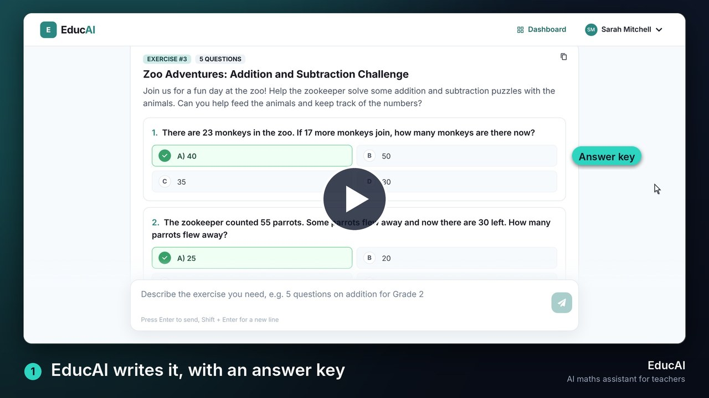
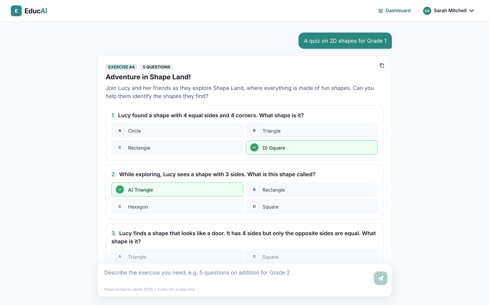
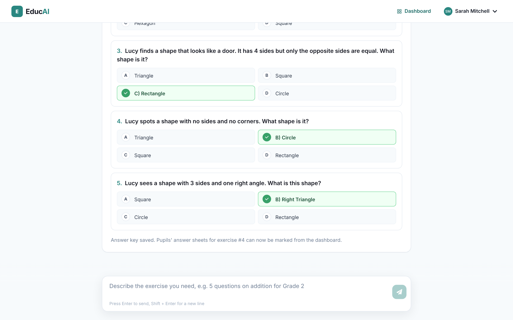
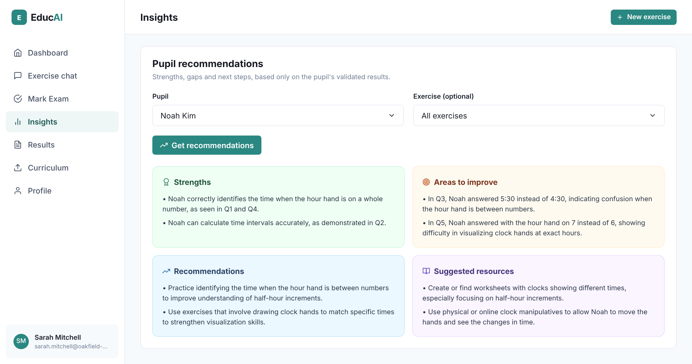
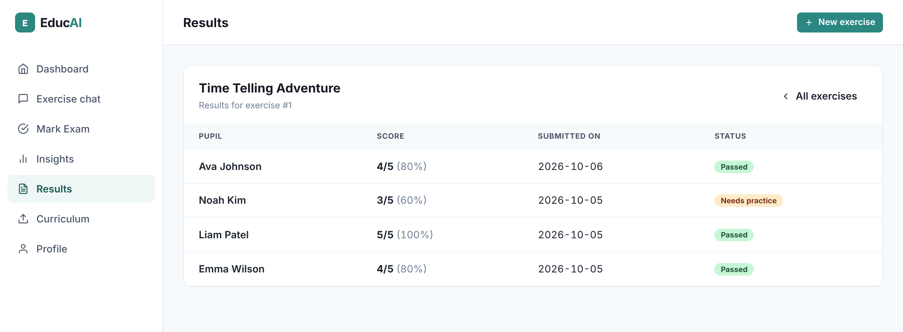

# EducAI: AI teaching assistant for primary maths

EducAI is a web app that helps primary school teachers create maths exercises and mark pupils' answer sheets with AI.

A teacher describes the exercise they need in plain English. EducAI writes a multiple-choice quiz with its answer key, following the curriculum, and saves it. When pupils hand in their answer sheets as PDFs, EducAI reads each sheet, marks it against the answer key and shows the result question by question. The teacher can adjust any mark before validating it. EducAI then writes personalised recommendations for each pupil from their results.

It combines:

- **LLMs and prompt engineering**: exercise generation from natural-language requests with OpenAI GPT, with a worked answer for every question so the answer key stays correct.
- **Retrieval-augmented generation (RAG)**: the curriculum PDF (the bundled one or the teacher's own) is split, embedded and searched with FAISS, so exercises follow the right programme.
- **Document AI**: answer sheets are read from PDF and turned into structured answers, then marked against the stored answer key.
- **Learning analytics**: dashboard metrics, per-exam results and AI recommendations based only on each pupil's actual scores.
- **Full-stack architecture**: FastAPI backend, React and Chakra UI frontend, JWT authentication, SQLite, Docker Compose.

EducAI was built by **Sulaiman FAYYAZ** and **Kamul ALI NASSOMA WATTARA** as their final-year **Master of Engineering** project (2025). They chose the topic themselves. The app was first written in French for French primary teachers (Cycle 2: CP, CE1, CE2, ages 6 to 8) and has since been translated to English.

---

## Demo

[](docs/demo/EducAI-demo.mp4)

*A one-minute silent walkthrough recorded from the running app, with real AI calls: ask for a quiz, mark a pupil's PDF answer sheet, then get advice for that pupil. The 14 seconds the AI took to write the quiz are cut, and the video says so on screen. Click the image to open the video ([MP4, 5 MB](docs/demo/EducAI-demo.mp4)).*

---

## Screenshots

#### 1. Ask for an exercise



*The teacher asks for a quiz in plain English, here a quiz on 2D shapes for Grade 1.*

#### 2. Generated quiz with its answer key



*EducAI returns a numbered exercise with four options per question and the correct answer, and saves it for marking.*

#### 3. Teacher dashboard


*The class at a glance (average score, sheets marked, pupils, exercises), the three steps of the workflow and the latest exercises. The menu leads to marking, insights, results, the curriculum upload and the profile.*

#### 4. Marking an answer sheet


*The teacher uploads a pupil's PDF answer sheet. EducAI reads it and marks every answer against the key; the teacher can edit any mark, then validates the result.*

#### 5. Personalised recommendations



*For one pupil across all their exercises: strengths, areas to improve with the exact question and answer, recommendations and suggested resources, based only on the pupil's actual results.*

#### 6. Exam results



*The results of one exercise: each pupil's score, date and status.*

---

## Key features

### Exercise generation
Teachers ask for exercises in the chat on the home page. They can specify:
- the grade (Grades 1 to 3; CP, CE1, CE2 in the French system)
- the topic (numbers, addition, subtraction, multiplication, money, time, measurement, geometry, logic puzzles)
- the number of questions and the difficulty

Each question has four options and exactly one correct answer. The model writes the working for every question before choosing the correct option, and malformed questions are dropped before saving. Requests that are not about primary maths get a polite refusal and nothing is saved.

### Marking pupils' answer sheets (PDF)
- An answer sheet gives the pupil's name and ID, the exercise ID, the date and one letter per question (see `backend/make_answer_sheet.py` to create one).
- EducAI extracts the answers, compares them with the stored answer key and computes the score, the per-question result and the success rate.
- The teacher can change any mark (0 or 1) before validating. Validated results are saved for that pupil.

### Dashboard and analytics
- Average score and number of exams marked, compared with the previous month
- List of exams with each pupil's result

### Personalised recommendations
For each pupil, across all exercises or for one exercise:
- strengths actually shown by the results
- areas to improve
- teaching recommendations
- suggested resources and exercises

### Curriculum upload
Teachers can upload their own curriculum PDF. New exercises are then generated from the most relevant passages of that document. Without an upload, EducAI uses the bundled curriculum (`backend/program/cycle2_maths.pdf`, the French Cycle 2 maths programme).

---

## Architecture

1. The teacher uses the **React** frontend.
2. The frontend calls the **FastAPI** backend over HTTP with a JWT.
3. The backend calls **OpenAI GPT** (through LangChain) to generate exercises, read answer sheets and write recommendations, and **OpenAI embeddings + FAISS** to search the curriculum.
4. Teachers, pupils, exercises, answers and results are stored in **SQLite** with SQLAlchemy.

| Layer | Technology |
| --- | --- |
| Backend | Python, FastAPI, SQLAlchemy, LangChain |
| AI | OpenAI GPT (default `gpt-4o`, set `OPENAI_MODEL` to change), OpenAI embeddings, FAISS |
| PDF | PyMuPDF, pypdf |
| Frontend | React, Chakra UI, Vite |
| Auth | JWT, bcrypt |
| Deployment | Docker, Docker Compose, nginx |

### Backend (`backend/`)
- `server.py`: API routes and authentication
- `llm_agent.py`: prompts and calls to the LLM (exercise generation, answer-sheet reading, recommendations) and curriculum retrieval
- `utils.py`: database queries, PDF text extraction, scoring
- `models.py`: SQLAlchemy models (table and column names are in French, see `database model definition/MCD.md`)
- `make_answer_sheet.py`: creates a sample answer sheet PDF
- `program/`: curriculum PDFs

### Frontend (`eduiafront/`)
- `src/pages/Home.jsx`: exercise chat
- `src/components/Layout/DashboardLayout.jsx`: dashboard, marking, insights, results
- `src/components/Auth/`: sign-in and registration
- `src/services/api.js`: API client

### Main endpoints
- `POST /register/`, `POST /login/`, `GET /me/`
- `POST /chat/`: generate an exercise from a request
- `POST /correct-exam/`: read and mark an answer sheet PDF
- `POST /save-result/`: save the validated score
- `POST /update_curriculum/`: upload a curriculum PDF
- `GET /metrics`, `GET /students`, `GET /exercises`, `GET /exams`, `GET /exam-results/{id}`
- `GET /recommendations/student/{id}`: recommendations for a pupil

---

## Running EducAI

### With Docker (recommended)
1. Install Docker and Docker Compose.
2. Create a `.env` file at the project root with `OPENAI_API_KEY=sk-...` (optionally `EDUCAI_JWT_SECRET` and `OPENAI_MODEL`).
3. Run:
   ```bash
   docker compose up --build
   ```
4. Open http://localhost:3000 (the API runs on http://localhost:8000, docs at http://localhost:8000/docs).

### Without Docker
Backend:
```bash
cd backend
python -m venv .venv && source .venv/bin/activate
pip install -r requirements.txt
export OPENAI_API_KEY=sk-...
uvicorn server:app --reload
```

Frontend:
```bash
cd eduiafront
npm install
npm run dev
```

### Try the whole flow
1. Create an account and sign in.
2. In the chat, ask for example: *"5 questions on addition and subtraction within 100 for Grade 2, set at a zoo"*. Note the exercise number.
3. Create an answer sheet for that exercise:
   ```bash
   cd backend
   python make_answer_sheet.py --exercise 1 --pupil-id 7 --name "Emma Wilson" --answers A C A A B --out samples/emma.pdf
   ```
4. In the dashboard, open **Mark Exam**, upload the PDF, check the marks and click **Validate results**.
5. Open **Insights**, choose the pupil and click **Get recommendations**.

A step-by-step guide is in [docs/USER_GUIDE.md](docs/USER_GUIDE.md).

---

## Security
- Passwords hashed with bcrypt
- JWT authentication on every teacher endpoint (60-minute tokens by default)
- Teachers can only see their own exercises, pupils and results
- Input validation with Pydantic

## Known limitations
- SQLite is fine for a single school but not for many concurrent users.
- Answer sheets must be typed PDFs in the format above; handwriting is not read.
- The app depends on the OpenAI API (quotas, latency, availability).
- Automated tests are not complete yet.

## Possible improvements
- PostgreSQL instead of SQLite
- Handwritten answer sheets (vision model)
- Printable answer sheets generated from each exercise
- Unit, integration and end-to-end tests
- Object storage for uploaded PDFs

---

## Authors
- **Sulaiman FAYYAZ**
- **Kamul ALI NASSOMA WATTARA**

Final-year **Master of Engineering** project (2025).
